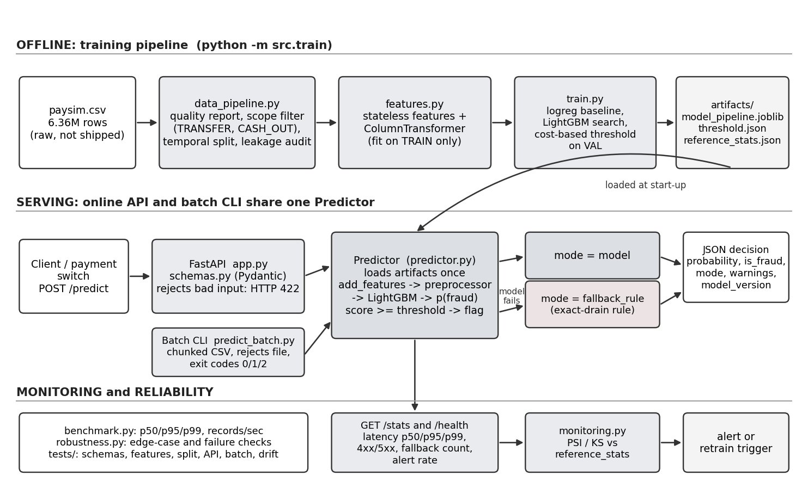

# Mini production ML system: transaction fraud detection (PaySim)

A fraud scorer built the way it would be shipped: leak-free temporal split, a
LightGBM model with cost-based thresholding, a FastAPI service and a batch CLI
that share one scoring class, latency/throughput benchmarks, edge-case checks
and a drift monitor.

## Quickstart

Needs Python 3.11+ (developed on 3.14). Put `paysim.csv` in `data/` first (see `data/README.md`).

Everything in one go (Windows PowerShell, from this folder):

```powershell
powershell -ExecutionPolicy Bypass -File .\run_all.ps1          # add -PyVersion "-3.12" if needed
```

Linux/macOS: `bash run_all.sh`. The script creates `.venv`, installs
`requirements.txt`, runs the tests, trains, evaluates, runs the drift
simulation, robustness checks and benchmarks, then writes `requirements.lock.txt`
(exact versions of the environment that produced the reported numbers).

Step by step:

```powershell
python -m venv .venv ; .\.venv\Scripts\Activate.ps1
pip install -r requirements.txt
pytest -q                               # unit tests (uses a tiny synthetic model, no dataset needed)
python -m src.train                     # about 2-3 min on a 16-core machine; --quick = smoke test
python -m src.evaluate                  # held-out test metrics, CIs, calibration, figures -> reports/
python -m src.backtest                  # rolling-origin backtest, five forward folds -> reports/backtest.json
python -m src.monitoring --simulate     # PSI/KS drift experiment + timeline -> reports/drift_report.json
python -m serving.robustness            # edge-case table -> reports/robustness.json
python -m serving.benchmark             # latency, scale-out, 60 s soak, throughput -> reports/benchmark.json
```

Expected end state: `pytest` ends with all tests passing, `reports/` holds `metrics.json`,
`backtest.json`, `drift_report.json`, `robustness.json`, `benchmark.json` and a `figures/` folder, and
`artifacts/` holds the serialised models and reference statistics.



## Troubleshooting

- *`paysim.csv not found`*: place the Kaggle file at `data/paysim.csv` (see `data/README.md`).
- *A package fails to install on a very new Python*: create the environment with an older
  interpreter, e.g. `py -3.12 -m venv .venv`, or pass `-PyVersion "-3.12"` to `run_all.ps1`.
- *Port already in use when serving*: pick another port (`--port 8001`); the benchmark chooses free ports itself.
- *PowerShell blocks scripts*: use the `-ExecutionPolicy Bypass` form shown above.
- *Numbers differ slightly from the report*: LightGBM uses all CPU cores and its tie-breaking can vary
  between machines. The versions that produced the report are in `requirements.lock.txt`.

## Serving

Online API:

```powershell
uvicorn serving.app:app --port 8000
```

```powershell
Invoke-RestMethod http://127.0.0.1:8000/health

$body = @{ transaction_id="demo-1"; step=700; type="TRANSFER"; amount=181000;
           oldbalanceOrg=181000; newbalanceOrig=0; oldbalanceDest=0; newbalanceDest=0 } | ConvertTo-Json
Invoke-RestMethod -Method Post -Uri http://127.0.0.1:8000/predict -ContentType "application/json" -Body $body
```

or with curl (bash):

```bash
curl -s localhost:8000/predict -H 'content-type: application/json' -d \
 '{"transaction_id":"demo-1","step":700,"type":"TRANSFER","amount":181000,"oldbalanceOrg":181000,"newbalanceOrig":0,"oldbalanceDest":0,"newbalanceDest":0}'
```

Endpoints: `GET /health`, `POST /predict`, `POST /predict/batch` (up to 1000 records), `GET /stats`.
Malformed payloads return 422 with the field-level reason. If the model cannot be
loaded or scoring raises, the service keeps answering with the heuristic rule
(`"mode": "fallback_rule"`) and `/health` reports `degraded`.

Batch CLI:

```powershell
python -m serving.predict_batch --input data/sample_transactions.csv --output reports/scores.csv
python -m serving.predict_batch --input data/sample_with_bad_rows.csv --output reports/demo_scores.csv   # shows rejects file
```

Output has `transaction_id, fraud_probability, is_fraud, mode`. Unusable rows go to
`<output>.rejects.csv` with a reason. Exit codes: 0 ok, 1 runtime failure, 2 bad input file.

## Results at a glance

Held-out test window (hours 601-743, 43,550 in-scope transactions, 1,600 fraud). Full tables are in
`reports/metrics.json` and `reports/results_table.md`; the report PDF discusses them.

| Model | PR-AUC | Precision | Recall |
|---|---|---|---|
| Exact-drain rule (strong baseline) | 0.965 | 1.000 | 0.964 |
| Logistic regression (class-weighted) | 0.896 | 0.476 | 0.991 |
| **LightGBM, pre-authorisation features (served)** | **0.9993** | **0.979** | **0.998** |
| LightGBM, sender balance hidden (ablation) | 0.582 | - | - |

Single-client API latency over 2,000 requests: p50 9.0 ms, p95 11.6 ms, p99 13.6 ms.
Offline batch scoring: about 247k records/s including CSV I/O (500k-row tiled sample).
Read the "simulator artifact" note below before interpreting the near-perfect PR-AUC.

## Layout

```
data/            sample files (raw PaySim is downloaded separately)
artifacts/       model_pipeline.joblib, baseline_logreg.joblib, threshold.json,
                 reference_stats.json, reference_sample.csv.gz, training summaries
src/
  config.py        every modelling constant (split cutoffs, cost model, thresholds)
  data_pipeline.py ingestion, quality report, temporal split, leakage audit
  features.py      stateless feature builder + sklearn preprocessor + heuristic rule
  train.py         baselines, LightGBM search, threshold selection, serialisation
  evaluate.py      metrics, cost analysis, plots (the only place the test set is used)
  monitoring.py    PSI / KS drift, reference stats, simulation CLI
serving/
  schemas.py       Pydantic request/response models
  predictor.py     artifact loading + scoring + fallback (shared by API and CLI)
  app.py           FastAPI service
  predict_batch.py batch CLI
  benchmark.py     latency / throughput profiling
  robustness.py    edge-case and failure-injection checks
tests/           pytest suite
reports/         metrics.json, benchmark.json, drift_report.json, robustness.json, figures/
```

## Design decisions in brief

- **Split.** Train = hours 1-450, validation = 451-600, test = 601-743. Only
  `TRANSFER` and `CASH_OUT` are modelled because every fraud case in PaySim is one of
  those two types; other types are answered by a rule (score 0) and never reach the model.
- **Leakage.** `isFlaggedFraud` (a simulator rule output) and the account ids are never
  loaded. Imputer, scaler and one-hot encoder are fitted on the training partition only.
  `data_pipeline.leakage_audit` and a unit test check this.
- **Feature availability.** `newbalanceOrig` and `newbalanceDest` only exist after a
  transaction is applied, and in PaySim they reveal how the simulator injects fraud
  (a model that sees them scores almost perfectly). The served model uses pre-authorisation
  fields only: type, amount, hour, and the two *old* balances. A second model that also sees
  the post-transaction balances is trained as an ablation and is never served.
- **A simulator artifact to be aware of.** About 98% of PaySim fraud moves exactly the
  sender's whole balance (`amount == oldbalanceOrg`) and no legitimate in-scope transaction
  does, so one rule scores near-perfectly and the model's PR-AUC is close to 1. That says
  more about the simulator than about real fraud. The report therefore compares the model
  with this exact-drain rule and with a sender-balance-blind ablation that hides the signature.
  The drain rule doubles as the API's fallback when the model is unavailable.
- **Imbalance.** Class weighting (`scale_pos_weight`, searched on validation) plus a
  decision threshold chosen by expected business cost on validation. No oversampling.
- **Metrics.** PR-AUC as the ranking metric; precision, recall, F1 at the chosen
  threshold; Recall at precision >= 0.9; expected cost against a "flag nothing" baseline.
  Raw accuracy is not reported as a result because predicting "legitimate" always scores >99%.
- **Cost model.** A missed fraud costs its amount; each flagged transaction costs 25 for
  review; a flagged legitimate one also costs 0.1% of its amount in customer friction.
  These are assumptions (see `src/config.py`); `reports/metrics.json` includes a
  sensitivity table over the friction rate.
